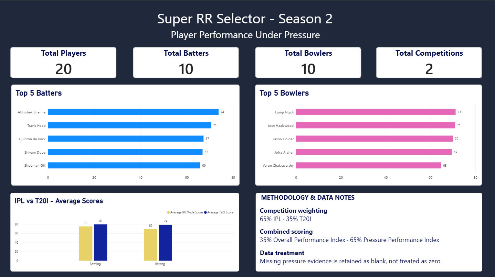
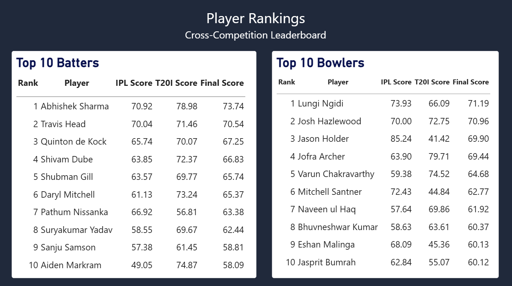
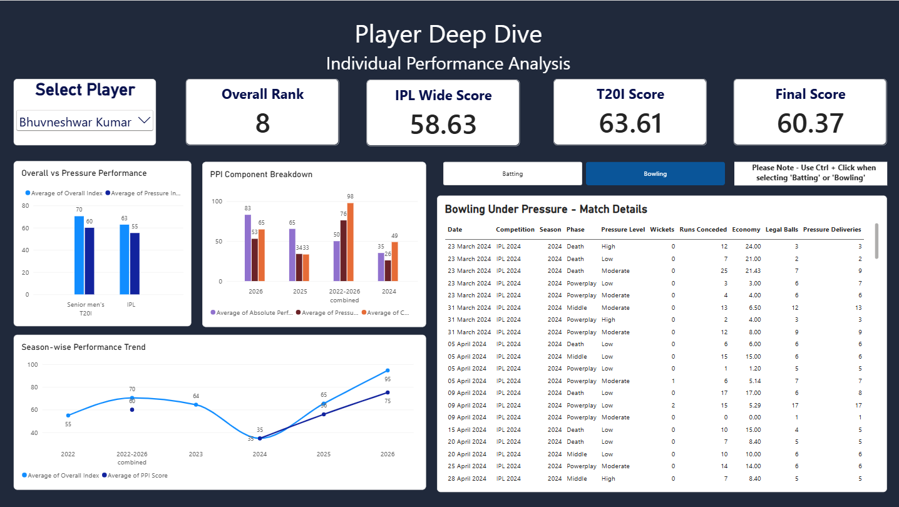
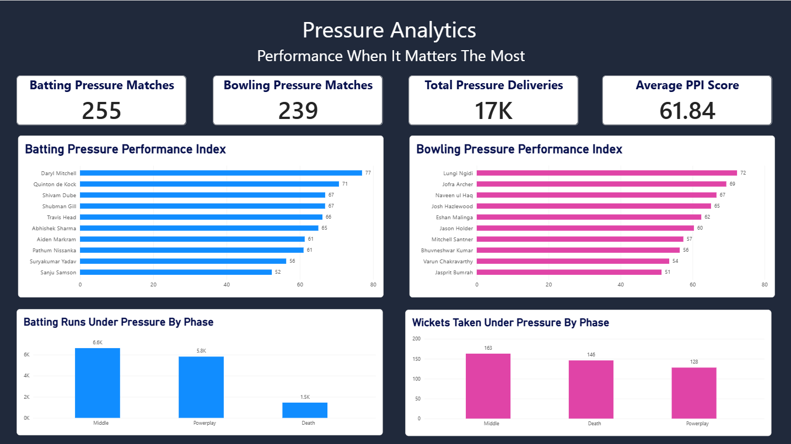

# SupeRR Selector – Season 2, Round 1

Identifying the most reliable batters and bowlers **under pressure** using ball-by-ball T20 data.

## 📊 Dashboard Preview

| Overview | Rankings |
|---|---|
|  |  |

| Deep Dive | Pressure Analytics |
|---|---|
|  |  |

The interactive dashboard source is [`dashboard/SuperRR_Dashboard.pbix`](dashboard/SuperRR_Dashboard.pbix). Download it and open it with [Power BI Desktop](https://powerbi.microsoft.com/desktop/) (free, Windows). A PDF export of the dashboard is in [`dashboard/SuperRR_Dashboard.pdf`](dashboard/SuperRR_Dashboard.pdf).

## Project Summary
- Reconstructed match state from ball-by-ball data and built a delivery-level **pressure model**
- Calibrated chase-success probabilities (wicket and run-rate adjustments) and par scores
- Built batting and bowling **pressure indices** with eligibility rules and reliability adjustment
- Aggregated across competitions (IPL, T20I) into final rankings and top-10 shortlists
- Validated with bootstrap stability checks and sensitivity analysis

Full methodology: [`reports/SupeRR_Selector_S2_Round1_Technical_Blueprint_v1.docx`](reports/SupeRR_Selector_S2_Round1_Technical_Blueprint_v1.docx)
Final report: [`reports/SupeRR_Selector_Report.pdf`](reports/SupeRR_Selector_Report.pdf)

## Repository Structure
```
├── dashboard/       Power BI file (.pbix), PDF export and screenshots
├── processed_data/  Dashboard-ready workbook
├── raw_data/        Supplied competition data pack (CSVs + problem statement)
├── reports/         Final report (PDF) and technical methodology blueprint
├── src/             Python scripts: data audit → pressure model → indices → validation
└── results/         Final shortlists and validation report (CSV)
```

## Reproducing the Analysis
The scripts in `src/` run roughly in this order: data audit and player-match stats → first-innings model and calibration → chase analysis → pressure states → player metrics → pressure indices → bootstrap reliability → combined scores → final validation.

Large intermediate outputs (pressure states, bootstrap replicates, etc.) are not included; running the scripts on `raw_data/` regenerates them.

## Tools
Python (pandas, scikit-learn/statsmodels-style modelling), Power BI, Excel.

## Author
**Tanishq Gharat** · [LinkedIn](https://linkedin.com/in/tanishq-gharat)
